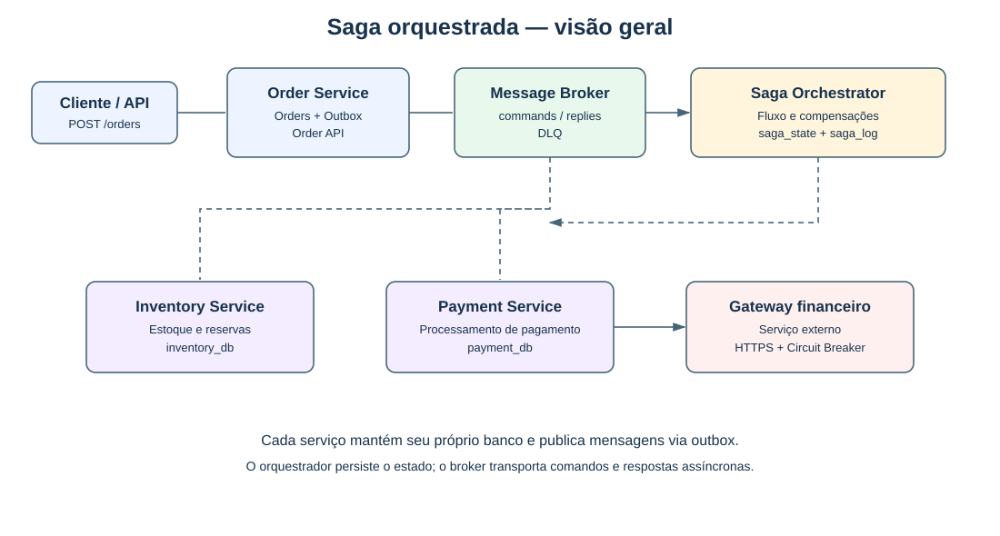
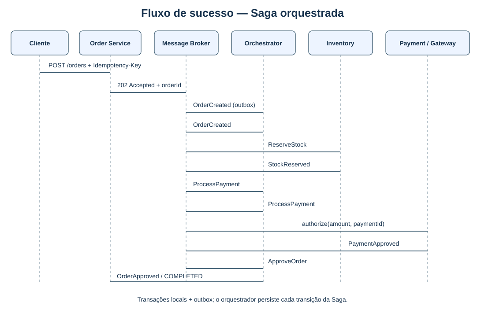
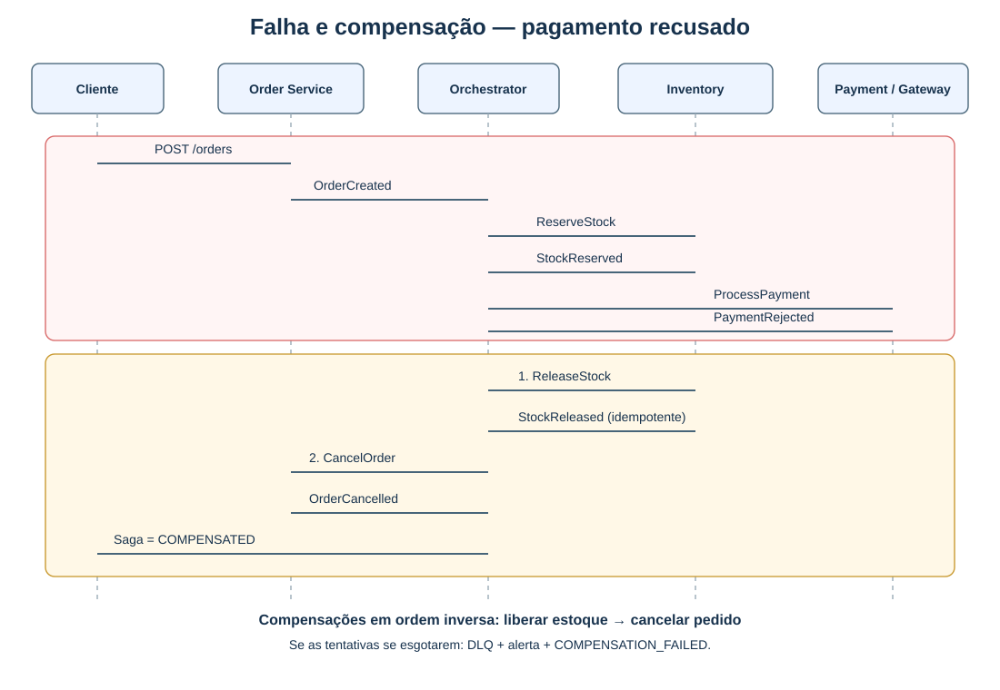
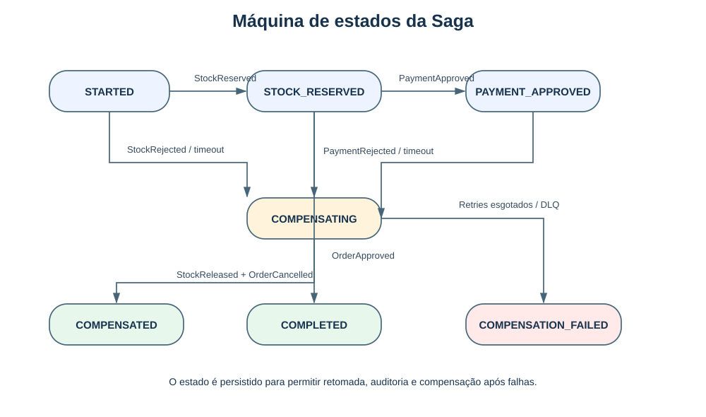

# Padrão Saga no E-commerce — Blueprint de Arquitetura

Blueprint de arquitetura para a migração de um monólito de comércio eletrônico para microsserviços, usando **Saga orquestrada** no fluxo crítico de compra. Este repositório contém documentação e diagramas, não uma implementação executável.

## Contexto

O fluxo envolve três domínios com bancos independentes:

- **Order Service:** ciclo de vida do pedido.
- **Inventory Service:** estoque e reservas temporárias.
- **Payment Service:** pagamentos por gateway externo.

Como não há uma transação ACID distribuída entre os serviços, a Saga coordena transações locais e compensações para convergir a um estado final consistente.

## Decisão arquitetural: Saga orquestrada

Adotamos um **Order Saga Orchestrator** persistente para controlar o estado e comandar os participantes por mensageria assíncrona. Essa escolha torna explícitos o fluxo, os timeouts e a ordem inversa das compensações. O risco de ponto único de falha é mitigado por múltiplas instâncias, estado persistido e controle otimista de concorrência.

| Critério | Orquestração | Coreografia |
|---|---|---|
| Visibilidade do fluxo | Centralizada e auditável | Distribuída entre eventos |
| Compensações | Ordem explícita | Regras distribuídas |
| Acoplamento | Contratos de comandos e respostas | Participantes reagem a eventos |
| Evolução | Fluxo alterado no orquestrador | Mudanças podem envolver vários serviços |
| Ponto único de falha | Mitigado com réplicas e estado persistido | Menor centralização |

A previsibilidade da compensação, auditoria e diagnóstico pesa mais neste cenário do que a menor centralização da coreografia.

## Diagramas

### Visão geral da arquitetura



### Sequência de sucesso



### Sequência de falha e compensação



### Máquina de estados



Os arquivos-fonte PlantUML (`.puml`) também estão em `diagrams/` e podem ser editados para atualizar os diagramas.

## Fluxo de sucesso

1. O cliente solicita a criação do pedido; o Order Service grava `PENDING` e publica `OrderCreated` pela outbox.
2. O orquestrador persiste a Saga e solicita `ReserveStock`.
3. O Inventory Service reserva o estoque e responde `StockReserved`.
4. O orquestrador solicita `ProcessPayment`; o Payment Service consulta o gateway e responde `PaymentApproved`.
5. O orquestrador solicita `ApproveOrder`; o pedido termina em `APPROVED` e a Saga em `COMPLETED`.

## Fluxo de falha e compensação

Se o pagamento for recusado após a reserva de estoque, o orquestrador inicia a compensação em ordem inversa:

1. `ReleaseStock`: liberar a reserva no Inventory Service.
2. `CancelOrder`: cancelar o pedido no Order Service.
3. Finalizar a Saga como `COMPENSATED` e notificar o cliente.

Se uma compensação falhar após as tentativas previstas, a Saga fica em `COMPENSATION_FAILED`, a mensagem segue para uma Dead-Letter Queue (DLQ) e a equipe é alertada para intervenção.

## Resiliência e idempotência

- **Idempotent Consumer:** `messageId` único e deduplicação persistida.
- **Idempotência de API:** `Idempotency-Key` na criação de pedidos.
- **Outbox:** evita perda entre commit local e publicação de mensagem.
- **Timeouts:** cada passo tem prazo persistido; pagamentos com resultado incerto exigem consulta ao gateway antes de compensar.
- **Retry:** backoff exponencial com jitter para falhas transitórias.
- **Circuit Breaker e Bulkhead:** isolam indisponibilidade do gateway.
- **DLQ e observabilidade:** mensagens problemáticas, estado da Saga e logs correlacionados são monitorados.

## Documentação técnica

Consulte [`docs/decisoes-arquiteturais.md`](docs/decisoes-arquiteturais.md) para os contratos de mensagens, modelo de estado, idempotência, matriz de falhas, timeouts, DLQ e estratégias de resiliência.

## Estrutura

```text
.
├── README.md
├── diagrams/
│   ├── saga-architecture-overview.svg / .puml
│   ├── sequence-success-flow.svg / .puml
│   ├── sequence-compensation-flow.svg / .puml
│   └── saga-state-machine.svg / .puml
└── docs/
    └── decisoes-arquiteturais.md
```

> **Escopo:** os diagramas são blueprints de arquitetura; este repositório não implementa os microsserviços nem substitui testes de integração.
